<p align="center">
  
</p>

<p align="center">
  <a href="https://hannsxpeter.com"></a>
  <a href="https://www.npmjs.com/org/hxp-tools"></a>
  <a href="https://sharetact.co"></a>
  <a href="https://linkedin.com/in/hannsxpeter"></a>
  <a href="https://x.com/hannsxpeter"></a>
</p>

<h3 align="center">AI engineer building agentic systems, MCP servers, and dev infrastructure.</h3>

<p align="center"><em>Creator of Godpowers. Scriveno. Mythify. Stack: TypeScript / Python / Rust / Bun Convex. Ottawa, Canada.</em></p>

> **Active quest:** Founder and Principal Consultant at **[Sharetact](https://sharetact.co)**. AI-forward automation and systems for government and growing business.

---

## Overworld map

Fourteen packages on [`@hxp-tools`](https://www.npmjs.com/org/hxp-tools), organized as an eight-world campaign from project briefing to production launch, plus a standalone writing campaign.

<p align="center">
  
</p>

## Stage select

| Stage | World | Package | Role | Version |
| :--- | :--- | :--- | :--- | :--- |
| `1` | **W7 · Brief** | **[@hxp-tools/pillars](https://www.npmjs.com/package/@hxp-tools/pillars)** | Your agent starts blank. Give it a briefing. Open standard on `AGENTS.md`. | [](https://www.npmjs.com/package/@hxp-tools/pillars) |
| `2` | **W1 · God** | **[@hxp-tools/godpowers](https://www.npmjs.com/package/@hxp-tools/godpowers)** | Durable project state, evidence-backed "done", and gates enforced by hooks | [](https://www.npmjs.com/package/@hxp-tools/godpowers) |
| `2` | **W1 · God** | **[@hxp-tools/godplans](https://www.npmjs.com/package/@hxp-tools/godplans)** | Ask, decide, grade, clear the gate before any code | [](https://www.npmjs.com/package/@hxp-tools/godplans) |
| `2` | **W1 · God** | **[@hxp-tools/goddesign](https://www.npmjs.com/package/@hxp-tools/goddesign)** | Draw one direction from a deck, lock it, clear a measured gate | [](https://www.npmjs.com/package/@hxp-tools/goddesign) |
| `2` | **W1 · God** | **[@hxp-tools/godaudits](https://www.npmjs.com/package/@hxp-tools/godaudits)** | Eighteen domains, 437 checks, scored reports, proof-gated change safety | [](https://www.npmjs.com/package/@hxp-tools/godaudits) |
| `3` | **W2 · Proof** | **[@hxp-tools/mythify](https://www.npmjs.com/package/@hxp-tools/mythify)** | Prove done. Plans close only on a passing check. Any model, zero dependencies. | [](https://www.npmjs.com/package/@hxp-tools/mythify) |
| `4` | **W3 · DNA** | **[@hxp-tools/codedna](https://www.npmjs.com/package/@hxp-tools/codedna)** | Fingerprint a codebase so AI contributions match the author | [](https://www.npmjs.com/package/@hxp-tools/codedna) |
| `4` | **W3 · DNA** | **[@hxp-tools/docdna](https://www.npmjs.com/package/@hxp-tools/docdna)** | Decide which documents a codebase owes; write what the code can prove | [](https://www.npmjs.com/package/@hxp-tools/docdna) |
| `5` | **W4 · Audit** | **[@hxp-tools/auditor-suite](https://www.npmjs.com/package/@hxp-tools/auditor-suite)** | Eight read-only audits. One domain each. Scored reports agents can act on. | [](https://www.npmjs.com/package/@hxp-tools/auditor-suite) |
| `6` | **W5 · Voice** | **[@hxp-tools/authenticity-check](https://www.npmjs.com/package/@hxp-tools/authenticity-check)** | Score text and flag AI-sounding spans. Never rewrites. | [](https://www.npmjs.com/package/@hxp-tools/authenticity-check) |
| `6` | **W5 · Voice** | **[@hxp-tools/humanizer](https://www.npmjs.com/package/@hxp-tools/humanizer)** | Strip the tells. Keep the facts. Sound like you. | [](https://www.npmjs.com/package/@hxp-tools/humanizer) |
| `6` | **W5 · Voice** | **[@hxp-tools/voiceprint](https://www.npmjs.com/package/@hxp-tools/voiceprint)** | One-pass prose authenticity: diagnose, clean, rewrite once, report | [](https://www.npmjs.com/package/@hxp-tools/voiceprint) |
| `7` | **W8 · Arc** | **[@hxp-tools/ready-suite](https://www.npmjs.com/package/@hxp-tools/ready-suite)** | Eleven composable skills from idea to launch. Artifacts are the contract. | [](https://www.npmjs.com/package/@hxp-tools/ready-suite) |
| `SIDE` | **W6 · Ink** | **[@hxp-tools/scriveno](https://www.npmjs.com/package/@hxp-tools/scriveno)** | Spec-driven creative writing, publishing, and translation. Blank page to published book. | [](https://www.npmjs.com/package/@hxp-tools/scriveno) |

<details>
<summary><b>Quick-start commands (all 14 packages)</b></summary>

```bash
# 1. Brief (W7)
npx @hxp-tools/pillars

# 2. God family (W1)
npx @hxp-tools/godpowers
npx @hxp-tools/godplans
npx @hxp-tools/goddesign
npx @hxp-tools/godaudits

# 3. Proof (W2)
npx @hxp-tools/mythify

# 4. DNA family (W3)
npx @hxp-tools/codedna
npx @hxp-tools/docdna

# 5. Audit (W4)
npx @hxp-tools/auditor-suite

# 6. Voice family (W5)
npx @hxp-tools/authenticity-check
npx @hxp-tools/humanizer
npx @hxp-tools/voiceprint

# 7. Launch arc (W8)
npx @hxp-tools/ready-suite

# Side quest: Ink (W6)
npx @hxp-tools/scriveno
```

</details>

<details>
<summary><b>How to play: a typical run through the map</b></summary>

1. **Brief** with `pillars` so the agent stops guessing.
2. **Plan and lock design** with `godplans` and `goddesign`; hold state with `godpowers`.
3. **Prove** every claim with `mythify` (exit 0 or it did not happen).
4. **Match** author style with `codedna` and `docdna`.
5. **Audit** with `auditor-suite` or `godaudits`.
6. **Keep the voice** with `authenticity-check`, `humanizer`, and `voiceprint` when prose ships.
7. **Launch** the full idea-to-ship arc with `ready-suite`.

`scriveno` is its own side campaign: books, not codebases.

</details>

---

## Loadout

<p align="center">
  
</p>

**Background:** 20 years in enterprise systems, data, and analytics. Now building AI full-time.

**What I care about:** evidence over vibes, gates over hope, tools that leave a trail you can check, and software people can own and self-host, not just rent.

<p align="center">
  <a href="https://hannsxpeter.com">hannsxpeter.com</a>
  ·
  <a href="https://github.com/hannsxpeter">GitHub</a>
  ·
  <a href="https://www.npmjs.com/org/hxp-tools">@hxp-tools</a>
  ·
  <a href="https://sharetact.co">Sharetact</a>
</p>
