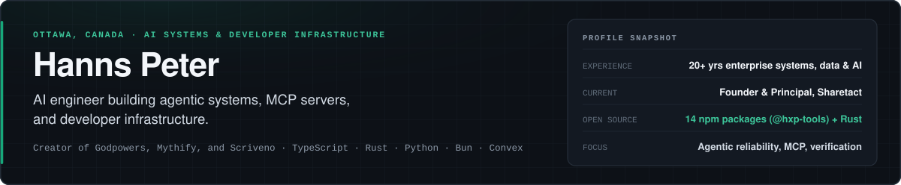
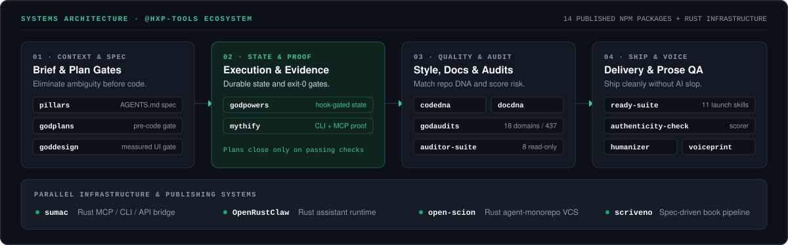

<p align="center">
  
</p>

<p align="center">
  <a href="https://hannsxpeter.com"></a>
  <a href="https://linkedin.com/in/hannsxpeter"></a>
  <a href="https://www.npmjs.com/org/hxp-tools"></a>
  <a href="https://sharetact.co"></a>
  <a href="https://x.com/hannsxpeter"></a>
</p>

## Overview

AI engineer building **agentic systems, MCP servers, and developer infrastructure** in TypeScript, Rust, and Python. Creator of **[Godpowers](https://github.com/hannsxpeter/godpowers)**, **[Mythify](https://github.com/hannsxpeter/mythify)**, and **[Scriveno](https://github.com/hannsxpeter/scriveno)**.

- **Currently:** Founder and Principal Consultant at **[Sharetact](https://sharetact.co)**, delivering AI-forward automation and production systems for government and growing businesses.
- **Background:** 20 years in enterprise systems, data, and analytics, now building AI infrastructure full-time from Ottawa, Canada.
- **Engineering focus:** Evidence over vibes, verification gates over hope, deterministic audit trails on disk, and self-hosted software teams can own rather than rent.

---

## Selected work

| Project | Stack | What it solves | Links |
| :--- | :--- | :--- | :--- |
| **[Godpowers](https://github.com/hannsxpeter/godpowers)** | TypeScript, Hooks, MCP | Keeps project memory on disk, enforces verification gates via hooks, and refuses unverified completion across AI coding tools. | [](https://www.npmjs.com/package/@hxp-tools/godpowers) |
| **[Mythify](https://github.com/hannsxpeter/mythify)** | Python, CLI, MCP | Zero-dependency evidence protocol (CLI and MCP server) where plans close only on a passing check. Works with any model. | [](https://www.npmjs.com/package/@hxp-tools/mythify) |
| **[Sumac](https://github.com/hannsxpeter/sumac)** | Rust, MCP, CLI | Single Rust binary bridging skills, MCP servers, and APIs: run any skill as an MCP server, any MCP server as a CLI, and any API from the terminal. | [GitHub](https://github.com/hannsxpeter/sumac) |
| **[OpenRustClaw](https://github.com/hannsxpeter/OpenRustClaw)** | Rust | Self-hosted, Rust-first assistant platform with a trust-first control plane, durable operator surfaces, and enterprise governance lanes. | [GitHub](https://github.com/hannsxpeter/OpenRustClaw) |
| **[open-scion](https://github.com/hannsxpeter/open-scion)** | Rust | Server-centric version control for agent-heavy monorepos in Rust, independently implementing concepts from Anthropic's source control design. | [GitHub](https://github.com/hannsxpeter/open-scion) |
| **[Scriveno](https://github.com/hannsxpeter/scriveno)** | JavaScript, Agents | Spec-driven writing, publishing, and translation pipeline for AI coding agents, from blank page to published book. | [](https://www.npmjs.com/package/@hxp-tools/scriveno) |
| **[Sveltry](https://github.com/hannsxpeter/sveltry)** | TypeScript, Bun, SvelteKit, Convex | Reactive, self-hosted, Sentry-compatible error tracker built on Bun, SvelteKit, self-hosted Convex, PostgreSQL, and Better Auth. | [GitHub](https://github.com/hannsxpeter/sveltry) |

---

## Agentic engineering ecosystem (`@hxp-tools`)

Fourteen published packages on [`@hxp-tools`](https://www.npmjs.com/org/hxp-tools), designed to compose across the full AI-assisted software delivery lifecycle.

<p align="center">
  
</p>

| Stage | Package | Purpose | Version |
| :--- | :--- | :--- | :--- |
| Context & Spec | **[@hxp-tools/pillars](https://github.com/hannsxpeter/pillars)** | Open standard on `AGENTS.md` so coding agents start with a structured project briefing. | [](https://www.npmjs.com/package/@hxp-tools/pillars) |
| Context & Spec | **[@hxp-tools/godplans](https://github.com/hannsxpeter/godplans)** | Structured questioning, decision locking, and pre-code plan grading before implementation starts. | [](https://www.npmjs.com/package/@hxp-tools/godplans) |
| Context & Spec | **[@hxp-tools/goddesign](https://github.com/hannsxpeter/goddesigns)** | Deterministic UI direction lock and measured visual verification gate. | [](https://www.npmjs.com/package/@hxp-tools/goddesign) |
| State & Proof | **[@hxp-tools/godpowers](https://github.com/hannsxpeter/godpowers)** | Durable project state on disk, evidence-backed completion, and hook-enforced gates. | [](https://www.npmjs.com/package/@hxp-tools/godpowers) |
| State & Proof | **[@hxp-tools/mythify](https://github.com/hannsxpeter/mythify)** | Zero-dependency evidence protocol (CLI and MCP). Plans close only on exit 0. | [](https://www.npmjs.com/package/@hxp-tools/mythify) |
| Quality & Audit | **[@hxp-tools/codedna](https://github.com/hannsxpeter/codedna)** | Fingerprints a codebase's conventions so AI contributions match the author's style. | [](https://www.npmjs.com/package/@hxp-tools/codedna) |
| Quality & Audit | **[@hxp-tools/docdna](https://github.com/hannsxpeter/docdna)** | Determines which docs a codebase owes, cites exclusions, and writes only what code can prove. | [](https://www.npmjs.com/package/@hxp-tools/docdna) |
| Quality & Audit | **[@hxp-tools/godaudits](https://github.com/hannsxpeter/godaudits)** | Eighteen engineering domains, 437 checks, scored reports, and proof-gated change safety. | [](https://www.npmjs.com/package/@hxp-tools/godaudits) |
| Quality & Audit | **[@hxp-tools/auditor-suite](https://github.com/hannsxpeter/auditor-suite)** | Eight read-only domain audits returning prioritized, agent-executable reports. | [](https://www.npmjs.com/package/@hxp-tools/auditor-suite) |
| Ship & Voice | **[@hxp-tools/ready-suite](https://github.com/hannsxpeter/ready-suite)** | Eleven composable skills from kickoff to production launch with artifact contracts. | [](https://www.npmjs.com/package/@hxp-tools/ready-suite) |
| Ship & Voice | **[@hxp-tools/authenticity-check](https://github.com/hannsxpeter/authenticity-check)** | Read-only prose diagnostic that scores text and flags AI-sounding spans without rewriting. | [](https://www.npmjs.com/package/@hxp-tools/authenticity-check) |
| Ship & Voice | **[@hxp-tools/humanizer](https://github.com/hannsxpeter/humanizer)** | Strips AI writing tells while preserving facts and original voice. | [](https://www.npmjs.com/package/@hxp-tools/humanizer) |
| Ship & Voice | **[@hxp-tools/voiceprint](https://github.com/hannsxpeter/voiceprint)** | One-pass prose authenticity pipeline: diagnose, clean, rewrite once, report. | [](https://www.npmjs.com/package/@hxp-tools/voiceprint) |
| Publishing | **[@hxp-tools/scriveno](https://github.com/hannsxpeter/scriveno)** | Spec-driven creative writing, publishing, and translation pipeline for books. | [](https://www.npmjs.com/package/@hxp-tools/scriveno) |

<details>
<summary><b>Additional projects and quick-start CLI commands</b></summary>

<br>

**Additional public projects**
- **[Clario](https://github.com/hannsxpeter/clario)**: AI marketing platform that sequences a brand's Company DNA and generates voice-matched, authenticity-scored creative (SvelteKit, Convex).
- **[arc-ready](https://github.com/hannsxpeter/arc-ready)**: Single-skill idea-to-launch lifecycle with plain-Markdown artifacts and durable agent memory.

**Quick-start commands (`npx`)**

```bash
npx @hxp-tools/pillars
npx @hxp-tools/godpowers
npx @hxp-tools/godplans
npx @hxp-tools/goddesign
npx @hxp-tools/godaudits
npx @hxp-tools/mythify
npx @hxp-tools/codedna
npx @hxp-tools/docdna
npx @hxp-tools/auditor-suite
npx @hxp-tools/authenticity-check
npx @hxp-tools/humanizer
npx @hxp-tools/voiceprint
npx @hxp-tools/ready-suite
npx @hxp-tools/scriveno
```

</details>

---

## Technical stack

| Area | Technologies |
| :--- | :--- |
| **Languages** | TypeScript, Rust, Python, Bash |
| **AI & Agent Infrastructure** | Model Context Protocol (MCP), multi-agent orchestration, hook-enforced verification gates, Claude, Claude Code, Codex, Cursor |
| **Runtime, Web & Data** | Bun, SvelteKit, Astro, Convex, PostgreSQL, Docker (self-hosted infrastructure) |

---

<p align="center">
  <a href="https://hannsxpeter.com">hannsxpeter.com</a>
  ·
  <a href="https://linkedin.com/in/hannsxpeter">LinkedIn</a>
  ·
  <a href="https://github.com/hannsxpeter">GitHub</a>
  ·
  <a href="https://www.npmjs.com/org/hxp-tools">@hxp-tools</a>
  ·
  <a href="https://sharetact.co">Sharetact</a>
</p>
