<p align="center">
  
</p>

<p align="center">
  <a href="https://hannsxpeter.com"></a>
  <a href="https://www.npmjs.com/org/hxp-tools"></a>
  <a href="https://linkedin.com/in/hannsxpeter"></a>
  <a href="https://x.com/hannsxpeter"></a>
</p>

<h3 align="center">The proof is shipped, not theoretical.</h3>

<p align="center"><em>Natural language is becoming the interface for building software. I build the parts that make that reliable, and that people can own rather than rent.</em></p>

**Currently:** Founder and Principal Consultant at **[Sharetact](https://sharetact.co)**. AI-forward automation and systems for government and growing business.

---

## World select

Fourteen packages on [`@hxp-tools`](https://www.npmjs.com/org/hxp-tools). Some share a family. Pick a world.

<p align="center">
  
</p>

### W1 · God family

Plan, lock design, keep state, audit with evidence. Same stack, different stage.

| Package | Role | Version |
| --- | --- | --- |
| **[@hxp-tools/godpowers](https://www.npmjs.com/package/@hxp-tools/godpowers)** | Durable project state, evidence-backed "done", and gates enforced by hooks | [](https://www.npmjs.com/package/@hxp-tools/godpowers) |
| **[@hxp-tools/godplans](https://www.npmjs.com/package/@hxp-tools/godplans)** | Ask, decide, grade, clear the gate before any code | [](https://www.npmjs.com/package/@hxp-tools/godplans) |
| **[@hxp-tools/goddesign](https://www.npmjs.com/package/@hxp-tools/goddesign)** | Draw one direction from a deck, lock it, clear a measured gate | [](https://www.npmjs.com/package/@hxp-tools/goddesign) |
| **[@hxp-tools/godaudits](https://www.npmjs.com/package/@hxp-tools/godaudits)** | Eighteen domains, 437 checks, scored reports, proof-gated change safety | [](https://www.npmjs.com/package/@hxp-tools/godaudits) |

```bash
npx @hxp-tools/godpowers
npx @hxp-tools/godplans
npx @hxp-tools/goddesign
npx @hxp-tools/godaudits
```

### W2 · Proof

| Package | Role | Version |
| --- | --- | --- |
| **[@hxp-tools/mythify](https://www.npmjs.com/package/@hxp-tools/mythify)** | Prove done. Plans close only on a passing check. Any model, zero dependencies. | [](https://www.npmjs.com/package/@hxp-tools/mythify) |

```bash
npx @hxp-tools/mythify
```

### W3 · DNA family

Fingerprint what the author already does, then make the agent match it.

| Package | Role | Version |
| --- | --- | --- |
| **[@hxp-tools/codedna](https://www.npmjs.com/package/@hxp-tools/codedna)** | Fingerprint a codebase so AI contributions match the author | [](https://www.npmjs.com/package/@hxp-tools/codedna) |
| **[@hxp-tools/docdna](https://www.npmjs.com/package/@hxp-tools/docdna)** | Decide which documents a codebase owes; write what the code can prove | [](https://www.npmjs.com/package/@hxp-tools/docdna) |

```bash
npx @hxp-tools/codedna
npx @hxp-tools/docdna
```

### W4 · Audit

| Package | Role | Version |
| --- | --- | --- |
| **[@hxp-tools/auditor-suite](https://www.npmjs.com/package/@hxp-tools/auditor-suite)** | Eight read-only audits. One domain each. Scored reports agents can act on. | [](https://www.npmjs.com/package/@hxp-tools/auditor-suite) |

```bash
npx @hxp-tools/auditor-suite
```

### W5 · Voice family

Diagnose AI tells, clean them, rewrite once. Never invent facts.

| Package | Role | Version |
| --- | --- | --- |
| **[@hxp-tools/authenticity-check](https://www.npmjs.com/package/@hxp-tools/authenticity-check)** | Score text and flag AI-sounding spans. Never rewrites. | [](https://www.npmjs.com/package/@hxp-tools/authenticity-check) |
| **[@hxp-tools/humanizer](https://www.npmjs.com/package/@hxp-tools/humanizer)** | Strip the tells. Keep the facts. Sound like you. | [](https://www.npmjs.com/package/@hxp-tools/humanizer) |
| **[@hxp-tools/voiceprint](https://www.npmjs.com/package/@hxp-tools/voiceprint)** | One-pass prose authenticity: diagnose, clean, rewrite once, report | [](https://www.npmjs.com/package/@hxp-tools/voiceprint) |

```bash
npx @hxp-tools/authenticity-check
npx @hxp-tools/humanizer
npx @hxp-tools/voiceprint
```

### W6 · Ink

| Package | Role | Version |
| --- | --- | --- |
| **[@hxp-tools/scriveno](https://www.npmjs.com/package/@hxp-tools/scriveno)** | Spec-driven creative writing, publishing, and translation. Blank page to published book. | [](https://www.npmjs.com/package/@hxp-tools/scriveno) |

```bash
npx @hxp-tools/scriveno
```

### W7 · Brief

| Package | Role | Version |
| --- | --- | --- |
| **[@hxp-tools/pillars](https://www.npmjs.com/package/@hxp-tools/pillars)** | Your agent starts blank. Give it a briefing. Open standard on AGENTS.md. | [](https://www.npmjs.com/package/@hxp-tools/pillars) |

```bash
npx @hxp-tools/pillars
```

### W8 · Arc

| Package | Role | Version |
| --- | --- | --- |
| **[@hxp-tools/ready-suite](https://www.npmjs.com/package/@hxp-tools/ready-suite)** | Eleven composable skills from idea to launch. Artifacts are the contract. | [](https://www.npmjs.com/package/@hxp-tools/ready-suite) |

```bash
npx @hxp-tools/ready-suite
```

---

## How to play

A typical run through the map:

1. **Brief** with Pillars so the agent stops guessing.
2. **Plan / design** with godplans and goddesign; hold state with godpowers.
3. **Prove** every claim with Mythify (exit 0 or it did not happen).
4. **Match** author style with codedna / docdna.
5. **Audit** with auditor-suite or godaudits.
6. **Keep the voice** with the Voice family when prose ships.
7. **Launch** the arc with ready-suite when the product needs the full idea-to-ship path.

Scriveno is its own campaign: books, not codebases.

---

## Stack

<div align="center">


**Daily drivers**


</div>

## Background

20 years in enterprise systems, data, and analytics. Now building AI full-time.

**What I care about:** evidence over vibes, gates over hope, tools that leave a trail you can check, and software people can own and self-host, not just rent.

<p align="center">
  <a href="https://hannsxpeter.com">hannsxpeter.com</a>
  ·
  <a href="https://github.com/hannsxpeter">GitHub</a>
  ·
  <a href="https://www.npmjs.com/org/hxp-tools">@hxp-tools</a>
</p>
